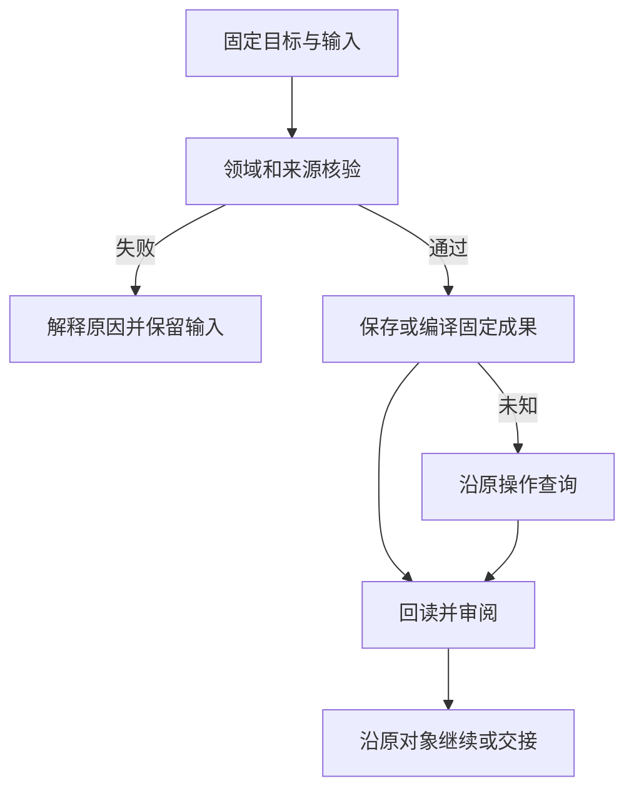

> 本文属于[互动叙事文档](README.md)。

# 用户用例与验收

| 编号 | 场景与必要断言 | 验收记录 |
| --- | --- | --- |
| CD-01 | 变量类型、条件和赋值不匹配拒绝 | 通过项、失败项及具体证据在08逐项记录 |
| CD-02 | 结构不可达与条件不可达分别报告 | 通过项、失败项及具体证据在08逐项记录 |
| CD-03 | 合法循环允许但执行有界 | 通过项、失败项及具体证据在08逐项记录 |
| CD-04 | 不可选路线、悬空目标和重复ID拒绝 | 通过项、失败项及具体证据在08逐项记录 |
| CD-05 | 同一选择序列的确定性回放 | 通过项、失败项及具体证据在08逐项记录 |
| CD-06 | 存档固定叙事摘要，工程改变不静默套用 | 通过项、失败项及具体证据在08逐项记录 |
| CD-07 | 离线HTML真实点击、存档和重载 | 通过项、失败项及具体证据在08逐项记录 |
| CD-08 | 路线交接只形成候选，不写正式正文 | 通过项、失败项及具体证据在08逐项记录 |
| CD-09 | 新建、单项更新、删除、查找、历史比较与导出 | 全动作 CLI/MCP 实测 |
| CD-10 | CAS冲突、同键异参、响应丢失与unknown | 保留原输入，不覆盖不重复执行 |
| CD-11 | 同Codex连接安装、Skill读取、停用、卸载重装 | 动态发现随实际状态变化 |
| CD-12 | 浅暗、窄窗、键盘、错误、冲突和关闭重开 | 真实Electron与计算样式断言 |
| CD-13 | 六插件接续同一创作对象 | 每次固定引用，下游不篡改上游 |

单元验证不变量，真实 CLI/MCP 验证公共链路，Electron 验证作者工作面，正式包验证发行内容。自动通过不代表作者认可、真实创作质量或其他系统已验收。
